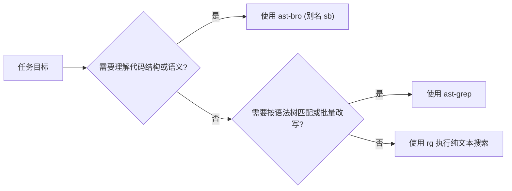

# AST 代码检索与改写指南（ast-bro 与 ast-grep）

本文面向 coding agent 与开发者，说明 `ast-bro` 与 `ast-grep` 的能力分工、命令用法、跨平台写法及静态分析边界。全文按 Diátaxis 框架分为四部分：快速上手、场景操作指南、命令速查参考、机制与边界说明。

---

## 一、工具选型与能力分工

在代码库中执行搜索、导航或重构前，先按任务目标选择工具。



| 场景 | 首选工具 | 核心命令 | 典型产出 |
| :--- | :--- | :--- | :--- |
| 陌生目录概览 | `ast-bro` | `ast-bro digest <dir>` | 各文件类型与公开方法清单 |
| 单文件结构大纲 | `ast-bro` | `ast-bro map <file>` | 签名与行号范围（省略函数体） |
| 提取单个符号源码 | `ast-bro` | `ast-bro show <path> <symbol>` | 目标符号完整实现 |
| 语义与关键词混合检索 | `ast-bro` | `ast-bro search "<query>"` | 按相关度排序的代码块列表 |
| 调用链与影响面分析 | `ast-bro` | `ast-bro impact <symbol>` | 调用方、被调方、反向依赖与关联测试 |
| 打包受控 Token 上下文 | `ast-bro` | `ast-bro context <symbol> --budget 8000` | 目标源码及周边签名摘要 |
| 一次性 AST 模式匹配与改写 | `ast-grep` | `ast-grep run -p '<pat>' -r '<new>'` | 语法树精确匹配结果与差异预览 |
| 仓库级规则扫描与自动化修复 | `ast-grep` | `ast-grep scan` | 基于 YAML 规则的批量检查与修复 |
| 规则回归测试 | `ast-grep` | `ast-grep test` | YAML 规则快照测试结果 |

> **说明**：`ast-bro` 内置了轻量级 `ast-bro run` 子命令，适合单次简单模式匹配；复杂规则组合、YAML 规则治理、交互式逐条确认与规则测试请使用 `ast-grep`。`sg` 为历史别名，当前运行会输出弃用警告（`WARNING: 'sg' is deprecated. Use 'ast-grep' instead.`），请统一使用 `ast-grep`。

---

## 二、快速上手（Tutorial）

用三个连贯步骤完成一次代码定位与安全改写（以下示例可直接在 PowerShell 执行）。

### 第 1 步：用 `ast-bro` 定位目标与影响面

先看目录结构，再提取影响范围与受控上下文，减少整文件读取消耗。

```powershell
# 1. 查看目录公开结构
ast-bro digest src/

# 2. 查看符号影响范围（调用方、被调方、依赖文件与测试）
ast-bro impact TakeDamage

# 3. 按 Token 预算一次拉取目标源码和周边签名
ast-bro context TakeDamage --budget 4000
```

### 第 2 步：用 `ast-grep` 只读预览匹配与差异

用单引号包裹模式字符串，省略 `-i` 和 `-U` 时处于只读预览模式。

```powershell
# 1. 先确认命中的文件列表
ast-grep run -p 'console.log($MSG)' --lang js --files-with-matches src/

# 2. 预览改写差异（此时保持磁盘文件不变）
ast-grep run -p 'console.log($MSG)' -r 'logger.info($MSG)' --lang js src/
```

### 第 3 步：确认无误后落盘并验证

预览差异符合预期后写入磁盘，随后执行 `git diff`、编译/解析检查与测试套件。

```powershell
# 人工逐条审核确认（按 y 接受、n 跳过）
ast-grep run -p 'console.log($MSG)' -r 'logger.info($MSG)' --lang js --interactive src/

# 或在预览确认后批量写入全部改写
ast-grep run -p 'console.log($MSG)' -r 'logger.info($MSG)' --lang js --update-all src/
```

---

## 三、场景操作指南（How-to Guides）

### 3.1 代码导航与上下文获取（`ast-bro`）

按由粗到细的顺序调用命令，拿到答案即可停止。

1. **目录摘要**：`ast-bro digest src/ --glob '*.ts' --max-members 10`
2. **单文件签名**：`ast-bro map src/service.py --detail signatures --no-docs`
3. **提取指定符号源码**：`ast-bro show src/Player.cs Player.TakeDamage`（多文件搜索默认上限 20 条，单文件提取无上限）
4. **追踪调用关系**：
   ```powershell
   # 直接调用方（加 --tests 仅看测试文件调用方）
   ast-bro callers run_impact --tests

   # 被调用方（加 --hide-external 隐藏外部未解析符号）
   ast-bro callees run_impact --hide-external

   # 两符号间最短静态调用路径
   ast-bro trace handle_request write_db --depth 12
   ```
5. **分析文件依赖与公开 API 面**：
   ```powershell
   ast-bro deps src/app.rs --depth 3
   ast-bro reverse-deps src/config.rs --depth 3 --exclude-tests
   ast-bro surface src/
   ```

### 3.2 语义检索与相似代码查找（`ast-bro`）

仅知道业务意图而不知道具体符号名时，使用混合检索（BM25 词法 + 向量语义）。

```powershell
# 混合检索（默认返回前 10 条）
ast-bro search "retry exponential backoff" --top-k 10

# 按语言过滤
ast-bro search "token refresh" --lang rust --lang python

# 查找与指定文件行号语义相近的代码块
ast-bro find-related src/auth.py:42
```

显式管理本地索引：

```powershell
ast-bro index            # 构建或增量刷新索引
ast-bro index --stats    # 查看索引统计信息（块数量、模型信息等）
ast-bro index --rebuild  # 清空缓存并全量重建索引
```

### 3.3 仓库级规则扫描与轻量改写

#### 仓库级规则扫描（`ast-grep scan`）

规则需要复用、包含复合条件（如 `inside`、`has`、`not`）或纳入 CI 时，使用 `scan`：

```powershell
# 使用单个规则文件扫描
ast-grep scan -r rules/no-eval.yml src/

# 使用内联 YAML 规则快速验证（PowerShell 单引号多行字符串）
ast-grep scan --inline-rules '
id: no-eval-js
language: javascript
rule:
  pattern: eval($A)
' src/

# 结合项目根目录 sgconfig.yml 执行全量扫描与规则测试
ast-grep scan
ast-grep test
```

#### 轻量模式改写（`ast-bro run`）

`ast-bro run` 支持 `$VAR` 与 `$$$` 元变量，默认只读预览，传入 `--write` 时落盘：

```powershell
# 只读预览
ast-bro run -p 'println!($$$ARGS)' -r 'tracing::info!($$$ARGS)' --lang rust src/

# 确认后写入
ast-bro run -p 'println!($$$ARGS)' -r 'tracing::info!($$$ARGS)' --lang rust --write src/
```

### 3.4 Windows、PowerShell 与跨平台注意事项

| 差异项 | PowerShell（Windows）写法 | Bash / Zsh（macOS / Linux）写法 | 说明 |
| :--- | :--- | :--- | :--- |
| 模式引号 | `ast-grep run -p 'foo($A)'` | `ast-grep run -p 'foo($A)'` | 跨平台统一使用单引号，防止双引号触发 `$A` 变量展开 |
| 含单引号的模式 | `ast-grep run -p 'log(''ok'', $A)'` | `ast-grep run -p "log('ok', \$A)"` | PowerShell 单引号内用两个单引号 `''` 表示字面单引号 |
| 命令名称与别名 | `ast-bro`（别名 `sb`）、`ast-grep` | `ast-bro`（别名 `sb`）、`ast-grep` | 本机均提供 `ast-bro`、`sb`、`ast-grep`；`sg` 已弃用并输出警告，脚本中统一写 `ast-bro` 与 `ast-grep` |
| 路径分隔与空格 | `ast-bro map "src/my folder"` | `ast-bro map "src/my folder"` | 跨平台统一使用正斜杠 `/`；含空格路径必须加引号 |
| 管道与标准错误 | 保留 stderr，检查 `$LASTEXITCODE` | 保留 stderr，检查 `$?` | `ast-bro` 将诊断与截断提示输出到 stderr，保留 stderr 以便排错 |
| JSON 机器解析 | `--json --compact` / `--json=stream` | `--json --compact` / `--json=stream` | Agent 解析输出时优先启用紧凑 JSON，避免 ANSI 颜色控制符干扰 |

---

## 四、命令与参数速查（Reference）

### 4.1 `ast-bro` 核心命令与契约

| 命令 | 作用 | 常用参数 |
| :--- | :--- | :--- |
| `map` / `digest` | 生成文件或目录结构大纲 | `--detail names\|signatures\|full`、`--no-docs`、`--no-private`、`--max-members N`、`--glob` |
| `show` | 提取指定符号源码 | `--limit N`（多文件默认 20） |
| `search` | BM25 + 向量混合检索 | `-k/--top-k N`（默认 10）、`--alpha 0.0..1.0`、`--lang`、`--rebuild` |
| `find-related` | 查找语义相似代码块 | `<FILE>:<LINE>` 或 `--file <FILE> --line <LINE>`、`-k/--top-k N`（默认 10） |
| `callers` / `callees` | 静态调用方 / 被调方 | `--depth N`（默认 1）、`--limit N`（默认 200）、`--tests`/`--exclude-tests`/`--hide-ambiguous`（`callers`）、`--hide-external`（`callees`） |
| `trace` | 两符号间最短调用路径 | `<FROM> <TO>`、`--depth N`（默认 12） |
| `impact` | 跨文件影响面汇总 | `--mode all\|deps\|dependents\|tests`、`--depth N`（默认 2）、`--limit N`（默认 200）、`--tests`、`--exclude-tests` |
| `context` | 按 Token 预算打包上下文 | `--budget N`（默认 8000，约 1 token ≈ 4 bytes） |
| `deps` | 正向导入依赖图 | `--depth N`（默认 3）、`--hide-external` |
| `reverse-deps` | 反向导入依赖图 | `--depth N`（默认 3）、`--limit N`（默认 200）、`--tests`、`--exclude-tests` |
| `cycles` | 检测导入循环依赖 | `--min-size N`（默认 2） |
| `surface` | 解析真实公开 API 面 | `--tree`、`--include-chain`、`--lang rust\|python\|fallback` |
| `index` | 构建或查看检索索引 | `--stats`（配合 `--json`）、`--rebuild` |
| `run` | AST 模式匹配与改写 | `-p`、`-r`、`-l/--lang`、`--glob`、`--write` |
| `mcp` | 以 stdio 启动 MCP 服务 | 无 |

#### `ast-bro` 退出码与截断字段

- **退出码**：
  - `0`：查询正常执行（包含结果合法为空的情况）。
  - `1`：内部错误；在 `run` 子命令中，退出码 `1` 表示有效模式未命中任何匹配（沿用 `grep` 约定）。
  - `2`：参数、路径或符号无效（路径缺失、符号缺失、未知参数、空参数列表等），stderr 输出诊断提示；启用 `--json` 时 stderr 同时输出 `ast-bro.error.v1` 错误对象。
  - `3`：仅 `cycles` 子命令在检测到循环依赖时返回。
- **JSON 输出**：查询命令均支持 `--json` 与 `--compact`（`index` 需配合 `--stats` 使用）。
- **截断信号**：
  - `truncated: true`：结果条数达到 `--limit` 或 `--max-members` 显示上限，真实总数记录在 `total`（`map --max-members` 同时提供 `dropped_members`）。
  - `frontier_truncated: true`：图遍历达到 `--depth` 深度上限，外层仍有未展开节点（`callers`/`callees`/`impact` 在 `--depth 1` 文本模式下省略 stderr 提示，JSON 字段仍准确置位）。

### 4.2 `ast-grep` 核心命令与元变量

| 命令 | 作用 | 常用参数 |
| :--- | :--- | :--- |
| `run` | 单次 CLI 模式搜索与改写（默认子命令） | `-p/--pattern`、`-r/--rewrite`、`-l/--lang`、`--strictness`、`--stdin`、`-i/--interactive`、`-U/--update-all`、`--globs`、`--json[=pretty\|stream\|compact]`、`--files-with-matches` |
| `scan` | 按配置或 YAML 规则批量扫描与修复 | `-c/--config`、`-r/--rule`、`--inline-rules`、`--filter`、`-i`、`-U`、`--format github\|sarif`、`--json` |
| `test` | 运行规则单元测试与快照校验 | `-t/--test-dir`、`-f/--filter`、`-U/--update-all` |
| `new` | 创建项目、规则或测试脚手架 | 子命令 `project\|rule\|test\|util`、`-l/--lang`、`-y/--yes` |

- **退出码**：`ast-grep run` 命中匹配时返回 `0`，未命中时返回 `1`；`ast-grep scan` 命中 `error` 级别规则时返回非零退出码。
- **常用元变量**：
  - `$NAME`：匹配单个具名 AST 节点，同名元变量要求匹配相同文本。
  - `$$$NAME`：匹配零个或多个连续 AST 节点（如参数列表、语句块）。
  - `$_`：匿名通配单个节点，多处出现各自独立匹配。

---

## 五、机制与边界说明（Explanation）

### 5.1 索引与嵌入模型使用条件（`ast-bro`）

1. **模型与下载条件**：混合检索默认使用 `minishlab/potion-code-16M`（256 维，CPU 本地推理）。首次构建语义索引时需本地已有模型缓存或具备联网下载条件；在离线环境使用前需提前准备好模型缓存。
2. **索引落盘位置**：首次执行 `ast-bro index`、`search` 或 `find-related` 时，会在仓库根目录生成 `.ast-bro/index/` 索引缓存目录（同时生成 `.ast-bro/.gitignore`）。建议在项目 `.gitignore` 中忽略 `.ast-bro/`。
3. **增量更新与重建**：运行 `ast-bro index` 或语义检索命令时按需刷新索引；大规模重构、切换大分支或怀疑缓存过期时，执行 `ast-bro index --rebuild` 全量重建。
4. **纯结构命令独立运行**：`map`、`digest`、`show`、`callers`、`callees`、`deps`、`reverse-deps`、`impact`、`context`、`run` 仅基于 AST 解析与本地图缓存运行，不触发语义索引与模型加载。

### 5.2 静态分析与改写的边界

`ast-bro` 与 `ast-grep` 均基于源码静态语法树工作，以下场景需结合人工核查与动态测试：

1. **动态派发与运行时绑定**：接口多态、回调函数、依赖注入容器、反射调用、动态 `import()` 与字符串拼接的方法名，无法在静态调用图中完整还原。
2. **宏展开与代码生成**：Rust 过程宏、C/C++ 复杂预处理宏、编译期生成的源码在未展开前呈现为原始语法节点，静态匹配仅覆盖源码字面结构。
3. **同名符号歧义**：多个类型定义相同方法名时，`ast-bro` 会将候选调用标记为 `Ambiguous` 并默认保留输出，需结合文件路径（`src/Foo.cs:Bar`）或人工核对缩小范围。
4. **深度截断与零命中核查**：
   - 看到 `frontier_truncated: true` 或 stderr 深度提示时，调高 `--depth` 复查。
   - `ast-bro run` 零命中时会报告 `files_scanned` 数量；若扫描文件数为 0，检查 `--lang` 与 `--glob` 过滤条件。
5. **改写后必须验证语法与行为**：AST 改写基于匹配节点执行模板替换，替换模板本身可能引入语法错误、类型不匹配或导入缺失。落盘后必须通过编译器、解析器、Linter 与单元测试验证语法有效性与业务逻辑正确性。
